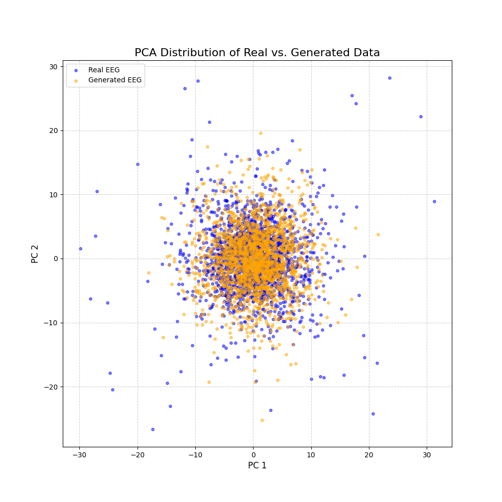
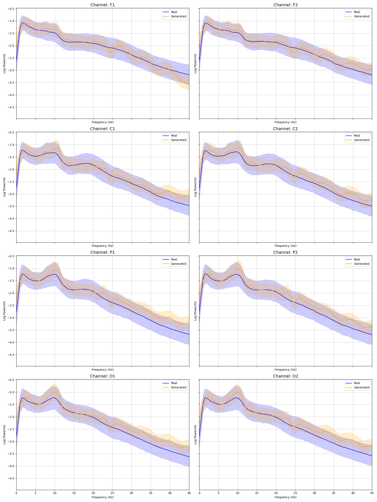

# ResGAN

A GAN in PyTorch that generates synthetic multi-channel EEG signals. The generator is built from residual blocks. This is research code, written as Kaggle notebooks.

## Problem

EEG datasets are small and hard to collect. Synthetic EEG is only useful if it keeps the frequency content and statistics of real EEG, not just its rough shape. This project trains a GAN to generate realistic EEG windows and measures how close they are to real data.

## How it works

- **Data:** preprocessed MPI-LEMON resting-state EEG, 8 channels × 512 time steps per window.
- **Generator** (`ResGenerator`): residual blocks (`ResBlock`) that turn random noise into an 8-channel EEG window.
- **Discriminator** (`ImprovedDiscriminator`): uses spectral normalization to keep training stable.
- **SWA:** a Stochastic Weight Averaging copy of the generator is trained alongside and compared with the best normal checkpoint.
- **Evaluation:** Fréchet distance (FD) on spectral features and on Hjorth parameters, plus PSD, PCA, histogram, time-series and channel-connectivity comparisons between real and generated EEG.
- **Downstream test:** features from the trained critic are used for an EEG classification task.
- `resgan-with-attention-v6.ipynb` is a variant that adds self-attention to the generator and discriminator.

| Generator | Discriminator |
|---|---|
|  |  |

## Results

From `resgan.ipynb` (normalized Fréchet distance, lower is better):

| Model | Spectral FD | Hjorth FD |
|---|---|---|
| Best standard checkpoint | **0.0590** | **0.1727** |
| SWA model | 0.0676 | 0.1751 |

Real vs generated EEG:

| PCA | Power spectral density |
|---|---|
|  |  |

More plots in the repo: `Final_SOTA__fig3b_histogram.png`, `Final_SOTA__fig4_timeseries.png`, `Final_SOTA__fig5_connectivity.png`, `final_training_curves_no_attention.png`, `final_fd_evolution_no_attention.png`.

## How to run

The notebooks were written for Kaggle with a GPU.

1. Open `resgan.ipynb` on Kaggle (or in Jupyter).
2. Add the preprocessed MPI-LEMON EEG data and point the data path at `lemon_preprocessed_8ch_512ts.npy`.
3. Install the packages if you run locally:

```bash
pip install torch numpy scipy scikit-learn matplotlib seaborn tqdm
```

## Notebooks

| Notebook | What it is |
|---|---|
| `resgan.ipynb` | Main residual GAN with SWA, evaluation and downstream test |
| `resgan-with-attention-v6.ipynb` | Variant with self-attention |
| `fork-of-resgan.ipynb`, `fork-of-fork-of-resgan.ipynb` | Earlier experiment versions |
| `ad-seek-v6-structured-complete-report.ipynb` | Related EEG experiment report |
